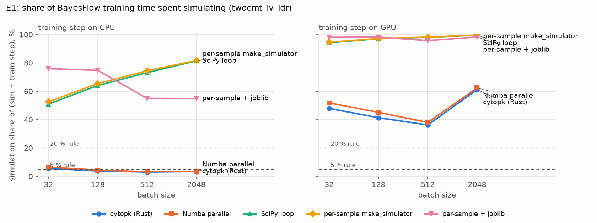
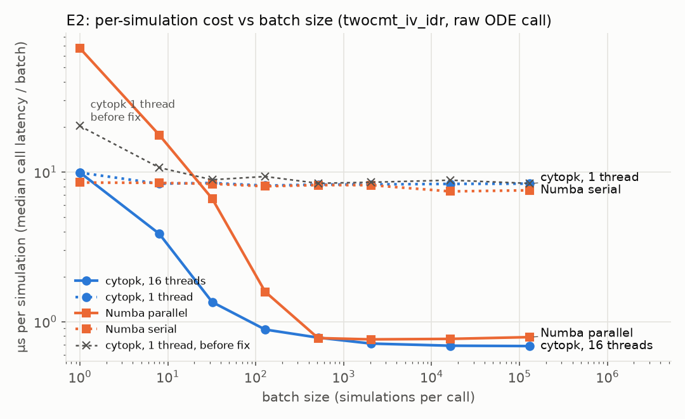
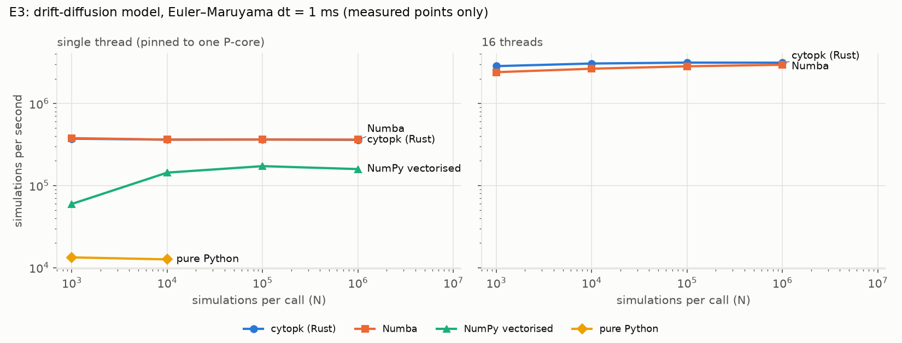

# Where does a Rust simulator matter in a BayesFlow workflow?

Measured, not assumed. The decision rules were committed (b3ecf04) **before** any measurement. Every number below comes
from a committed `results/*.json`, rendered into tables by `make_tables.py`, with figures from `plots.py`.

## Decision rules (fixed in advance)

1. Rust is **"critical for speed"** in an SBI flow only if both of these hold:
   - with a reasonable baseline implementation, simulation is **at least ~20 % of training time** at realistic batch sizes, **and**
   - cytopk beats the best baseline (Numba, nogil/parallel) by **at least 1.5×** at those batch sizes.
2. If cytopk is only **competitive with Numba**, the case for Rust is not speed. It is determinism, no JIT warm-up,
   no compiler at runtime, no Python dependency, and robust file I/O.
3. If simulation is **under ~5 % of training time**, simulator speed does not matter for this workflow on this hardware.

"Realistic batch sizes" means 32–512, the range of typical BayesFlow training batch sizes. 2048 is reported as an upper end.

## Verdicts

| rule | training on CPU | training on GPU (RTX 5060 Ti) |
|---|---|---|
| 1. "critical for speed": share ≥ ~20 % with a reasonable baseline **and** cytopk ≥ 1.5× the best baseline | **not met.** With a compiled simulator the share is 3.0–6.5 %. | **not met.** The share is ≥ 20 % (Numba: 38.0–51.7 % at B = 32–512), but cytopk's t_sim is only 1.08–1.17× lower than Numba's (16 threads) and 1.00–1.05× (8 threads), short of 1.5× |
| 2. only competitive with Numba → the case is determinism, no JIT, no compiler at runtime, no Python dependency, file I/O | **applies** | **applies** |
| 3. share < ~5 % → simulator speed does not matter | **applies for any compiled simulator** at B ≥ 128 (3.0–4.6 %); 5.6–6.5 % at B = 32. Does **not** apply to SciPy-loop or per-sample simulators (51–82 %) | does not apply (36.2–62.3 % for compiled simulators with 16 threads, up to 68.6 % with 8) |

**Where Rust matters in an SBI flow.** In this workflow the large speed step is going from a Python-level simulator
(per-sample `make_simulator`, a SciPy `solve_ivp` loop, or joblib's `sample_parallel`) to *any* compiled batched
simulator:
- with CPU training that cuts the simulation share from 51–82 % to 3.0–6.5 %;
- with GPU training, from 94–99.5 % to 36–62 % (16 threads).

Rust and Numba running the same Dormand–Prince design are close: cytopk's t_sim is 1.05–1.17× lower, and on the
stochastic DDM single-thread throughput is 0.98–1.00× of Numba's, so a well-written Numba kernel gets almost all of the speed.

With a GPU the simulator is a real cost (36–62 % of training time with 16 threads), but the **ODE solve is not where the time goes**.
Inside the BayesFlow process, cytopk's own Rust stage is 16–40 % of its t_sim. The NumPy noise stage, the BayesFlow
adapter (a fixed ~1.0–1.5 ms per call) and the prior take the rest. Even an ODE stage that took zero time would leave the
GPU-training share at 26–48 % (sum of the other measured stages).

A second effect is environmental. With JAX loaded in the same process, the same ODE call is 5.3× slower for cytopk
(1.46 → 7.80 ms at B = 2048) and 5.8× slower for Numba (1.56 → 9.03 ms) than in a clean process (E1 vs E2). NumPy
stages that follow a multi-threaded call are also slowed (E2b). I have not identified the mechanism; idle threads use
no CPU.

So, measured on this machine: the case for Rust here is **not raw speed**. It is:
- **no JIT warm-up:** first call 0.002 s for cytopk vs 1.69 s for Numba in E1, and 0.01 vs 0.54–1.01 s in E3;
- **determinism by construction:** bit-identical across thread counts, tested;
- **no compiler at runtime;**
- **the possibility of moving the noise stage and the per-call Python overhead into the same compiled batch,** which is
  where the remaining simulation time is.

## Setup

Intel(R) Core(TM) i5-14400F (16 logical CPUs: 6 P-cores with HT + 4 E-cores), GPU NVIDIA GeForce RTX 5060 Ti, 580.178.04, 16311 MiB; Linux-6.17.0-1023-oem-x86_64-with-glibc2.39; Python 3.13.13; BayesFlow 2.1.0, Keras 3.15.1, JAX/jaxlib 0.12.0.1 (+ jax-cuda13-plugin 0.12.0.1), Numba 0.68.1, NumPy 2.5.4, SciPy 1.18.1, joblib 1.6.0; rustc 1.99.1 (58cf8f9c3 2026-10-13). Training uses the JAX backend (CPU: `JAX_PLATFORMS=cpu`; GPU: `JAX_PLATFORMS=cuda,cpu`, on the
RTX 5060 Ti, which works with the CUDA 13 wheels). Simulators always run on the CPU. Networks: BayesFlow defaults,
`bf.networks.CouplingFlow()` + `bf.networks.TimeSeriesNetwork()` via `BasicWorkflow`. Pinned environment:
`requirements.lock`.

**Model** (`common.py`): `twocmt_iv_idr`, one 200 mg 1-hour infusion, 9 sampling times (0.04–28 days). Prior:
log-normal around the illustrative values in `docs/models.md`, sd 0.3. Inference target: log θ (7 values).
Observations: log-normal PK noise (σ 0.15) and beta-binomial gate counts (n = 10 000, φ = 100). The noise stage is the
same NumPy code for every implementation. Tolerances are those tuned to an achieved max relative error ≤ 1e-6 in
`benchmarks/bench_nonlinear.py`.

**Simulator wrappers.** `bf.simulators.make_simulator` returns a `SequentialSimulator` for per-sample functions;
`sample_parallel` exists on it (joblib) and is tested as (e). Batched simulators use `LambdaSimulator(is_batched=True)`.
`t_sim` is `simulator.sample((B,))` plus the workflow adapter, exactly what `OnlineDataset.__getitem__` does.

## E1: simulation share of BayesFlow training

`python e1_share.py sim`, `python e1_share.py step --device cpu|gpu` → `results/e1_sim.json`, `e1_step_cpu.json`,
`e1_step_gpu.json`. The fast simulators (Numba, cytopk) are measured **in one process with BayesFlow loaded,
interleaved round-robin, 80 rounds per batch size**. A first design with one process per implementation gave
process-to-process differences larger than the effect being measured (see `docs/decisions.md`). The slow simulators
run in their own processes. The two `e1_step_*.json` files record `git_dirty: true` only because `e1_sim.json`, an
output of the same run, was not yet committed; the code was unchanged at 5548e67.



**t_sim** (ms, median; simulator.sample + adapter → float32; CPU):

| simulator | B=32 | B=128 | B=512 | B=2048 |
|---|---:|---:|---:|---:|
| (a) per-sample `make_simulator` (solve_ivp) | 39 | 153 | 617 | 2,474 |
| (b) batched SciPy solve_ivp loop | 36.5 | 144 | 577 | 2,437 |
| (e) (a) + `sample_parallel` (joblib, 16 jobs) | 111 | 240 | 259 | 679 |
| (c) Numba parallel, nogil (16 threads) | 2.42 | 3.69 | 7.13 | 20.6 |
| (d) cytopk (16 threads) | 2.08 | 3.16 | 6.61 | 19.6 |
| (c) Numba parallel (8 threads) | 2.19 | 3.44 | 8.39 | 27.2 |
| (d) cytopk (8 threads) | 2.17 | 3.43 | 8 | 25.6 |

**t_step** (ms, median of steps 11–60; first step = XLA compile, in parentheses):

| device | B=32 | B=128 | B=512 | B=2048 |
|---|---:|---:|---:|---:|
| CPU | 35.1 (3.2 s) | 81.1 (3.3 s) | 212 (3.0 s) | 558 (4.2 s) |
| GPU | 2.26 (15.0 s) | 4.49 (16.7 s) | 11.6 (18.2 s) | 12.5 (23.0 s) |

**Simulation share** t_sim / (t_sim + t_step), training on **CPU**:

| simulator | B=32 | B=128 | B=512 | B=2048 |
|---|---:|---:|---:|---:|
| (a) per-sample `make_simulator` (solve_ivp) | 52.6 % | 65.4 % | 74.4 % | 81.6 % |
| (b) batched SciPy solve_ivp loop | 51.0 % | 64.0 % | 73.1 % | 81.4 % |
| (e) (a) + `sample_parallel` (joblib, 16 jobs) | 75.9 % | 74.7 % | 55.0 % | 54.9 % |
| (c) Numba parallel, nogil (16 threads) | 6.5 % | 4.4 % | 3.3 % | 3.6 % |
| (d) cytopk (16 threads) | 5.6 % | 3.8 % | 3.0 % | 3.4 % |
| (c) Numba parallel (8 threads) | 5.9 % | 4.1 % | 3.8 % | 4.6 % |
| (d) cytopk (8 threads) | 5.8 % | 4.1 % | 3.6 % | 4.4 % |

**Simulation share** t_sim / (t_sim + t_step), training on **GPU**:

| simulator | B=32 | B=128 | B=512 | B=2048 |
|---|---:|---:|---:|---:|
| (a) per-sample `make_simulator` (solve_ivp) | 94.5 % | 97.2 % | 98.2 % | 99.5 % |
| (b) batched SciPy solve_ivp loop | 94.2 % | 97.0 % | 98.0 % | 99.5 % |
| (e) (a) + `sample_parallel` (joblib, 16 jobs) | 98.0 % | 98.2 % | 95.7 % | 98.2 % |
| (c) Numba parallel, nogil (16 threads) | 51.7 % | 45.1 % | 38.0 % | 62.3 % |
| (d) cytopk (16 threads) | 47.9 % | 41.3 % | 36.2 % | 61.1 % |
| (c) Numba parallel (8 threads) | 49.2 % | 43.4 % | 41.9 % | 68.6 % |
| (d) cytopk (8 threads) | 48.9 % | 43.3 % | 40.8 % | 67.2 % |

**Where cytopk's t_sim goes** (16 threads, ms, medians):

| stage | B=32 | B=128 | B=512 | B=2048 |
|---|---:|---:|---:|---:|
| prior (NumPy) | 0.0699 | 0.111 | 0.25 | 0.832 |
| ODE (Rust) | 0.334 | 0.76 | 2.24 | 7.8 |
| noise (NumPy log-normal + beta-binomial) | 0.464 | 0.942 | 2.68 | 9.23 |
| BayesFlow adapter | 1.01 | 1.08 | 1.25 | 1.45 |
| ODE, Numba 16 threads, same rounds | 0.717 | 1.23 | 2.83 | 9.03 |

**cytopk vs Numba** (same process, interleaved): ratio Numba / cytopk:

| quantity | B=32 | B=128 | B=512 | B=2048 |
|---|---:|---:|---:|---:|
| t_sim, 16 threads | 1.17× | 1.17× | 1.08× | 1.05× |
| t_sim, 8 threads | 1.01× | 1.00× | 1.05× | 1.06× |
| ODE stage only, 16 threads | 2.14× | 1.62× | 1.27× | 1.16× |

**Offline dataset build** (simulator.sample, seconds) and cold start (first call incl. JIT / joblib pool start, seconds):

| simulator | 10^5 | 10^6 | cold start |
|---|---:|---:|---:|
| (a) per-sample `make_simulator` (solve_ivp) | 118.8 ¹ | 1,192.7 ¹ | 0.051 |
| (b) batched SciPy solve_ivp loop | 119.5 ¹ | 1,186.5 ¹ | 0.049 |
| (e) (a) + `sample_parallel` (joblib, 16 jobs) | 41.2 ¹ | 300.2 ¹ | 2.321 |
| (c) Numba parallel, nogil (16 threads) | 0.2 | 1.6 | 1.690 |
| (d) cytopk (16 threads) | 0.2 | 1.6 | 0.002 |

¹ Measured on 2000 simulations and scaled linearly.

Agreement of the noise-free ODE outputs with cytopk at rtol 1e-12 (200 draws from the prior, max relative error): scipy_loop 2.9e-07, numba_parallel 2.5e-08, cytopk 2.5e-08, numba_serial 2.5e-08.

## E2: batch-size and overhead sweep

`python e2_overhead.py --tag before|after` → `results/e2_overhead_before.json`, `e2_overhead_after.json`. Median call latency in **µs**
(raw noise-free ODE call unless marked). Single-thread rows are pinned to one P-core; one subprocess per implementation.

**Finding and fix.** Before the fix, `n_threads=1` cost about 9 µs even with zero simulations. The call was handed to
a cached 1-thread Rayon pool, and waking its worker took that long, about one simulation's worth of time. Now
`n_threads=1`, and any batch smaller than `MIN_PARALLEL_BATCH = 4`, runs on the calling thread (`Parallelism::Serial`).
Results are bit-identical, which is tested. At batch 1 the latency fell from 20.3 to 9.9 µs (1 thread) and from 21.8 to
9.9 µs (16 threads), level with Numba serial (8.5 µs). From batch 8 up, cytopk with 16 threads has the lowest latency
of the raw calls, except at batch 512, where Numba parallel is level (397 vs 400 µs). Numba parallel is slow at small batches (67 µs at batch 1, 212 µs at 32). At the largest batch, Numba
serial is 1.11× faster than cytopk on one thread (132,539 vs 119,685 sims/s), while cytopk with 16 threads is 1.15× faster
than Numba parallel.



| impl | 1 | 8 | 32 | 128 | 512 | 2,048 | 16,384 | 131,072 |
|---|---:|---:|---:|---:|---:|---:|---:|---:|
| cytopk 1 thread — **before fix** | 20.3 | 85.5 | 284 | 1,194 | 4,301 | 17,482 | 144,409 | 1,099,468 |
| cytopk 1 thread | 9.9 | 66.8 | 270 | 1,038 | 4,221 | 16,908 | 136,361 | 1,095,142 |
| cytopk 16 threads — **before fix** | 21.8 | 30.5 | 43.2 | 113 | 396 | 1,453 | 11,269 | 89,566 |
| cytopk 16 threads | 9.9 | 30.9 | 43.2 | 113 | 400 | 1,460 | 11,305 | 89,938 |
| Numba serial | 8.5 | 67.7 | 267 | 1,027 | 4,185 | 16,716 | 121,498 | 988,933 |
| Numba parallel | 67.2 | 141 | 212 | 203 | 397 | 1,558 | 12,558 | 103,213 |
| BayesFlow LambdaSimulator + cytopk | 48.4 | 485 | 761 | 1,654 | 5,400 | 17,944 | 26,830 | 205,883 |
| BayesFlow LambdaSimulator + Numba | 356 | 88.3 | 654 | 1,587 | 5,460 | 3,618 | 29,217 | 221,777 |

Throughput at the largest batch (131,072), sims/s: cytopk_1thread 119,685, numba_serial 132,539, cytopk_default 1,457,366, numba_parallel 1,269,924.

**E2b noise-stage interference** (NumPy noise stage, ms, median of 40; main thread free vs pinned to one P-core after the pools exist):

| condition | B=512 free | B=512 pinned | B=2048 free | B=2048 pinned | B=16384 free | B=16384 pinned |
|---|---:|---:|---:|---:|---:|---:|
| noise alone | 0.57 | 0.50 | 3.32 | 1.53 | 13.84 | 13.94 |
| after cytopk 16 threads | 2.50 | 2.01 | 9.22 | 1.56 | 17.38 | 13.52 |
| after numba parallel 16 threads | 2.53 | 0.47 | 9.14 | 1.74 | 13.69 | 13.59 |
| after cytopk 1 thread | 0.43 | 0.43 | 1.60 | 1.58 | 13.75 | 13.68 |

E2b (`e2_interference.py` → `results/e2_interference.json`): with the main Python thread free to move, the NumPy noise stage
takes 2.8–4.4× longer right after a 16-thread call (from cytopk or from Numba) at B = 512–2048. Pinning only the main thread
to one P-core removes it at B = 2048, and after Numba at B = 512. After cytopk at B = 512 the pinned stage is still
4× slower than alone (2.01 vs 0.50 ms). It appears after both simulators. I have not identified the mechanism; the
candidates are scheduler placement on this hybrid CPU, hyperthread sharing and frequency behaviour.

## E3: drift-diffusion model (stochastic, RNG-bound)

`python e3_ddm.py` → `results/e3_ddm.json`. Euler–Maruyama, s = 1, start z·a, boundaries 0 and a, dt = 1 ms, max 10 s,
non-decision time t0. Prior for timing: v ~ U(−2, 2), a ~ U(0.8, 2), z ~ U(0.3, 0.7), t0 ~ U(0.1, 0.5).

**RNG per implementation** (the simulator is RNG-bound, so this matters):

| implementation | generator | normal sampler |
|---|---|---|
| pure Python | MT19937 (`random.Random(seed)`) | `random.gauss` |
| NumPy vectorised (time-step loop, active set compacted every step) | PCG64 (`np.random.default_rng`) | ziggurat (`standard_normal`) |
| Numba (`nogil`, serial / `prange`) | xoshiro256++ per trial, seeded from (seed, i) via SplitMix64 | Marsaglia polar |
| cytopk (`cytopk.simulate_ddm`, Rust) | the same xoshiro256++ per trial from (seed, i) | Marsaglia polar |

Numba and cytopk use the same algorithm, and their outputs are **bit-identical**, which is checked.

**Correctness gate.** The script exits before writing results if any check fails. Each implementation must satisfy
`|p̂ − P_corr| ≤ 4 SE + 0.1 |P − P_corr|`. Here P is the analytic `(1 − e^(−2vza)) / (1 − e^(−2va))`, and P_corr
applies the Broadie–Glasserman–Kou correction for discrete monitoring (boundaries moved outward by 0.5826 √dt). The
10 % term allows for that correction being first-order only. Against cytopk, each implementation must also have a
two-proportion |z| < 4 and a KS p > 1e-3 for RT. This rule was fixed before measuring. The uncorrected P is off by
0.008–0.009 for every implementation, 1.8–3.5× the tolerance, so the correction is needed.



| implementation | threads | N=1,000 | N=10,000 | N=100,000 | N=1,000,000 | cold start (s) |
|---|---|---:|---:|---:|---:|---:|
| pure Python | 1 (pinned) | 13,328 | 12,603 | 12,566 ¹ | 12,615 ¹ | 0.01 |
| NumPy vectorised | 1 (pinned) | 59,667 | 143,696 | 172,229 | 158,611 | 0.03 |
| Numba serial | 1 (pinned) | 378,024 | 362,406 | 363,595 | 362,507 | 0.54 |
| cytopk 1 thread | 1 (pinned) | 372,203 | 362,135 | 363,941 | 359,777 | 0.01 |
| Numba parallel (16) | 16 | 2,402,509 | 2,647,315 | 2,834,269 | 2,958,180 | 1.01 |
| cytopk (16 threads) | 16 | 2,847,279 | 3,063,568 | 3,142,714 | 3,133,771 | 0.01 |

¹ pure Python measured up to N = 10,000; the per-simulation rate is constant, so larger N reuse it (time scaled linearly).

**Correctness gate** (θ = v 1.0, a 1.5, z 0.4, t0 0.3): P (continuous) = 0.73542, P_corr (discrete-monitoring correction) = 0.74412.

| implementation | n | p̂ | abs(p̂ − P_corr) | tolerance | abs(p̂ − P) | z vs cytopk | KS p vs cytopk |
|---|---:|---:|---:|---:|---:|---:|---:|
| pure Python | 200,000 | 0.74391 | 0.00021 | 0.00477 | 0.00848 | +0.12 | 0.641 |
| NumPy vectorised | 1,000,000 | 0.74462 | 0.00050 | 0.00262 | 0.00919 | +1.37 | 0.591 |
| Numba serial (bit-identical to cytopk) | 1,000,000 | 0.74377 | 0.00035 | 0.00262 | 0.00835 | +0.00 | 1.000 |
| cytopk (16 threads) | 1,000,000 | 0.74377 | 0.00035 | 0.00262 | 0.00835 | — | — |

All checks pass: **True**.

As expected, cytopk and Numba are close:
- **Single thread:** cytopk runs at 0.98–1.00× of Numba's throughput.
- **16 threads:** cytopk is 1.06–1.19× faster.
- **vs NumPy vectorised:** both compiled versions are 2.3× faster at N = 10^6 and 6.2× faster at N = 10^3.
- **vs pure Python:** about 28× faster.

## E4 (stretch): not done

BayesFlow 2.1's `DiskDataset` loads **one file per simulation** (default `*.pkl`, read via `pickle_load`), and each batch
is a list of files. Writing 10^7 simulations for it means 10^7 files. That benchmarks the filesystem, not a streaming
writer, and a sharded format would need a custom `load_fn`, which `DiskDataset` doesn't read as shards. I
stopped here instead of building a format BayesFlow does not load.

## Reproduce

```sh
uv venv .venv-sbi --python 3.13 && uv pip install --python .venv-sbi/bin/python -r benchmarks/sbi_flow/requirements.lock
(cd python && VIRTUAL_ENV=$PWD/../.venv-sbi ../.venv-sbi/bin/maturin develop --release)
export KERAS_BACKEND=jax
JAX_PLATFORMS=cpu .venv-sbi/bin/python benchmarks/sbi_flow/e2_overhead.py --tag after
JAX_PLATFORMS=cpu .venv-sbi/bin/python benchmarks/sbi_flow/e2_interference.py
JAX_PLATFORMS=cpu .venv-sbi/bin/python benchmarks/sbi_flow/e1_share.py sim
JAX_PLATFORMS=cpu .venv-sbi/bin/python benchmarks/sbi_flow/e1_share.py step --device cpu
JAX_PLATFORMS=cuda,cpu .venv-sbi/bin/python benchmarks/sbi_flow/e1_share.py step --device gpu
JAX_PLATFORMS=cpu .venv-sbi/bin/python benchmarks/sbi_flow/e3_ddm.py
.venv-sbi/bin/python benchmarks/sbi_flow/plots.py && .venv-sbi/bin/python benchmarks/sbi_flow/make_tables.py
```
